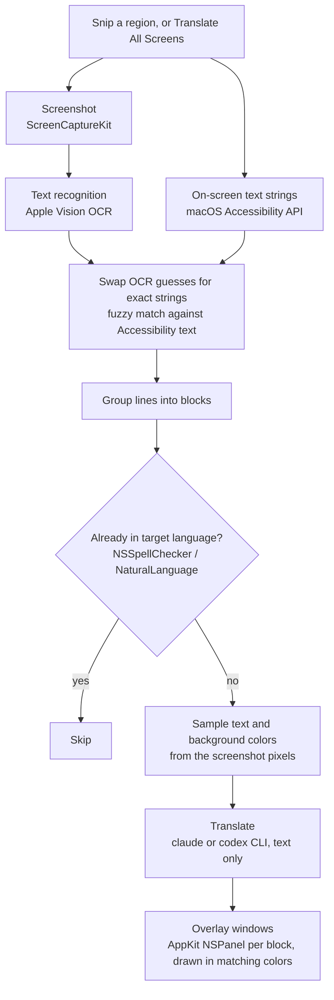
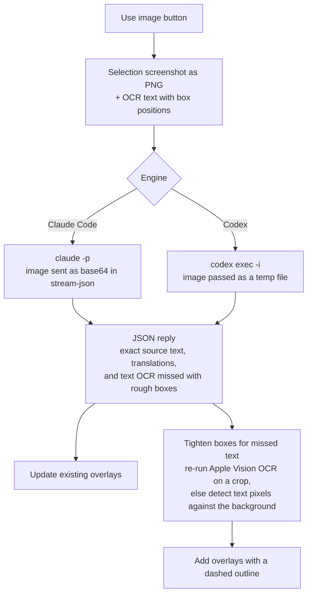

# Snipas

From [_labas_](https://www.learnlt.com/lithuanian-greetings) to _hello_ in one snip.

Menu bar app for macOS 15+. Press **⌃⌥T**, drag a rectangle over anything on screen, and the text inside it is translated with the local `claude` or `codex` CLI and overlaid in place. (Menu ▸ **Translate All Screens** does every display at once, skipping text already in your target language.)

- Hover a box → see the original pixels underneath
- Click → copy translation · ⌥-click → copy original
- ⌃⌥⇧T → hide/show all overlays · Esc → dismiss · Esc / right-click while selecting → cancel

## Build
```sh
xcodegen
xcodebuild -scheme Snipas -derivedDataPath build build   # or open Snipas.xcodeproj
open build/Build/Products/Debug/Snipas.app
xcodebuild -scheme Snipas -derivedDataPath build test
# real CLI round-trips (costs a few tenths of a cent):
TEST_RUNNER_INSTA_INTEGRATION=1 xcodebuild -scheme Snipas -derivedDataPath build test -only-testing:SnipasTests/EngineIntegrationTests
```
CI (`.github/workflows/ci.yml`) builds an ad-hoc-signed Release on every push to `main` (or manually from the Actions tab) and uploads `Snipas.zip` as an artifact.

Grant **Screen Recording** (required) and **Accessibility** (recommended) on first run in System Settings ▸ Privacy & Security, then relaunch.

## Notes
- **Text detection is hybrid.** Vision OCR finds where text is on screen. Each recognized line is then matched against the real strings apps expose through Accessibility, comparing in a folded alphabet where common OCR confusions (ė/e, ų/y, į/j…) count as equal, and replaced with the exact text when it matches. Text in images, video or games, or with Accessibility off, falls back to the OCR reading. Text in windows hidden behind others won't match anything visible, so it's ignored.
- **Likely source languages** (Settings, default Lithuanian) steer OCR and tell the model to assume that language when text is ambiguous. Vision has no Lithuanian recognizer, so OCR uses Czech/Polish glyph sets with language correction off, and the model restores diacritics.
- **Status bar** under the selection stays up while translations are shown: `Lithuanian → English · 4 translated · Claude Code` (the source language is reported by the model). It has a **✕** button (or press Esc) to dismiss.
- Translation is **text-only** by default. **Use image** in the status bar re-runs the selection with its screenshot. The model gets each line's position, returns the exact source text (fixing misreads), and adds text the recognizer missed. Those added boxes are snapped onto the text and drawn with a dashed outline. If the recognizer found nothing at all, it reads the whole image instead.
- Claude calls run with `--safe-mode --strict-mcp-config --tools "" --system-prompt …` so each call carries only the prompt (about a cent per call with Sonnet, the default model) instead of your full Claude Code context.
- Codex runs `codex exec --ephemeral --sandbox read-only --output-schema …` with low reasoning effort.

## How it works

### Capture → overlay


### “Use image”: sending the screenshot to Claude Code or Codex

